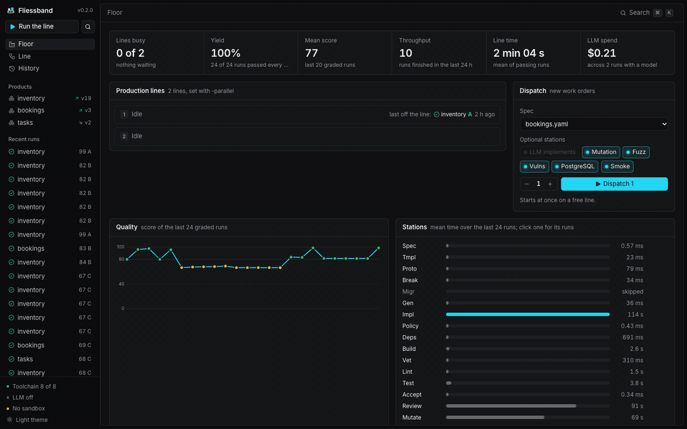

<p align="center">
  <picture>
    <source media="(prefers-color-scheme: dark)" srcset="docs/logo-dark.svg">
    
  </picture>
</p>

<h1 align="center">Fliessband</h1>

<p align="center">
  <b>An assembly line for Go gRPC microservices that measures everything it builds.</b><br>
  Write a short spec. Get a production-ready service, tested against your examples,<br>
  and a report that tells you how far to trust it.
</p>

<p align="center">
  <a href="https://github.com/tillknuesting/fliessband/actions/workflows/ci.yml"></a>
  
  <a href="LICENSE"></a>
</p>

<p align="center">
  
</p>

<p align="center">
  <sub>Dispatch work orders on the floor · watch the line run · explore the service blueprint · see which model won the tournament and why · audit security with file:line evidence · compare product versions down to the code. <a href="docs/demo.mp4">Watch as video</a>.</sub>
</p>

*Fließband* (FLEES-bahnt) is German for assembly line.

## Why

An LLM can write a microservice in a minute. Whether you should ship it is a
different question, and "the tests pass" doesn't answer it, because models
that can see the tests learn to satisfy the tests.

Fliessband splits the work so that the answer is measurable:

- **Templates build the structure.** The proto, the server, the stores, TLS,
  health, Kubernetes manifests and CI come from reviewed templates, the same
  way every time.
- **The LLM writes only business logic**, in two files, and nothing else.
  Anything outside them is rejected.
- **Your examples are the spec.** Each example in the YAML becomes an
  acceptance test the model can't edit. Examples marked `holdout` are never
  shown to it at all.
- **Every station measures.** Mutation testing, fuzzing, race detection,
  vulnerability scans, a real PostgreSQL and a load test check what was built,
  and the results add up to one score with every part explained.

## Quick start

You need Go 1.27 and, for the PostgreSQL station, Docker (Docker Desktop,
Colima, or similar).

```bash
git clone https://github.com/tillknuesting/fliessband && cd fliessband
make tools   # pinned buf, protoc plugins, golangci-lint, staticcheck, govulncheck
make serve   # UI on http://127.0.0.1:7070
```

Pick an example spec in the UI and press **Run the line**. The UI is keyboard-first: ⌘K opens the command menu, ⌘↵ runs the line, `[` hides the spec, and `G` then `H` or `L` switches between history and the line. Or from the terminal:

```bash
make run SPEC=specs/inventory.yaml
```

Each run is kept in `data/runs/<id>/`: the spec, `run.json` with every
station's log and measurement, the generated `service/`, an SBOM and the
provenance statement.

## The spec

```yaml
name: inventory
package: acme.inventory.v1
entities:
  - name: Product
    fields:
      - {name: sku, type: string, required: true, unique: true, pattern: "^SKU-[0-9]{3,6}$", example: "SKU-001"}
      - {name: stock, type: int32, min: 0}
methods:
  - name: AdjustStock
    doc: Changes the stock by delta. FAILED_PRECONDITION if it would drop below zero.
    request: [{name: sku, type: string}, {name: delta, type: int32}]
    response: [{name: product, type: Product}]
    examples:
      - name: adds units
        given: {Product: [{sku: SKU-100, title: Widget, stock: 5}]}
        request: {sku: SKU-100, delta: 3}
        expect: {product.stock: 8}
      - name: refuses to go below zero
        given: {Product: [{sku: SKU-100, title: Widget, stock: 5}]}
        request: {sku: SKU-100, delta: -6}
        error: FAILED_PRECONDITION
      - name: changes only the product with that sku
        holdout: true          # never shown to the LLM
        given: {Product: [{sku: SKU-100, title: A, stock: 1}, {sku: SKU-200, title: B, stock: 10}]}
        request: {sku: SKU-200, delta: 2}
        expect: {product.id: "${Product.1.id}", product.stock: 12}
```

Entities get create, get, list (with keyset paging), update and delete for
free. Custom methods like `AdjustStock` are what the LLM implements.

- Values can refer to seeded records with `${Entity.index.field}`.
- Expect paths use proto field names; numbers index into lists and `#` is a
  list's length.
- Features (`otel`, `postgres`, `kubernetes`, `ci`, `docker`, `health`,
  `reflection`) are switched on or off under `features:`.

### Authentication and access rules

An optional `auth:` block makes the service identify callers and check a
rule on every RPC. Without it the service accepts every caller, as before.

```yaml
auth:
  jwt:                       # bearer JWTs, RS256 or ES256, keys from the JWKS
    issuer: https://idp.example.com
    audience: bookings
    jwks_url: https://idp.example.com/.well-known/jwks.json
  mtls_identity: true        # optional: a verified client certificate identifies callers without a token
  roles_claim: roles         # default roles; dots reach into objects, e.g. realm_access.roles
  default: authenticated     # rule for RPCs without one: authenticated (default), public or deny
entities:
  - name: Room
    access: {create: [admin], update: [admin], delete: [admin], get: public, list: public}
methods:
  - name: CheckAvailability
    access: [guest, frontdesk, admin]
    examples:
      - name: needs a role
        as: []               # the caller's roles; unset means every role the spec names
        error: PERMISSION_DENIED
```

- A rule is `public`, `authenticated`, `deny`, or a list of roles of which
  the caller needs one. Entities name rules per operation, methods one rule.
- Missing or bad credentials return `UNAUTHENTICATED`, a missing role
  `PERMISSION_DENIED`. Credentials that are sent must be valid, even on
  public RPCs.
- Health and reflection never need credentials, so probes and grpcurl work.
- Acceptance examples call as a caller holding every role unless they say
  `as:`. `specs/bookings.yaml` is the worked example.

The UI shows the generated proto contract live as you type.

### Versions and schema migrations

A deployed database outlives the version that created it, so each run
migrates from the previous version of the service: the last passing run, or
the run it improves on when that one passed. Its migration files are copied
forward unchanged and the difference between its spec and yours becomes the
next file, such as `0002_add_reviews.sql`. A first version gets
`0001_init.sql`.

- Safe changes go through: new entities and fields, dropped unique indexes,
  looser constraints, widened types (`int32` to `int64`, `float` to
  `double`), and renames. New columns get the zero value as their default,
  which is what older clients see for an unset field.
- Destructive changes stop the line at the Migrations station with a list:
  dropped entities or fields, other type changes, tighter constraints, a new
  required field or a new unique field on an existing entity.
- A renamed entity or field would look like a drop plus an add. Say what it
  was called and it is renamed instead:

```yaml
entities:
  - name: Item
    renamed_from: Product        # ALTER TABLE products RENAME TO items
    fields:
      - {name: code, type: string, renamed_from: sku}
migrations:
  allow_destructive: true        # this version only: let the listed changes through
```

With `allow_destructive`, tighter constraints are added `NOT VALID`, so
PostgreSQL enforces them for new writes without checking existing rows.
Remove the flag once that version is out.

## The line

Twenty-two stations in five phases. Gates stop the line when they fail; checks
report and let it continue. Some gates send failures back to the LLM, up to
three times.

| Phase | Station | Tool | Gate |
|---|---|---|---|
| Contract | Spec, Scaffold | validation, templates | yes |
| | Proto lint | `buf lint` STANDARD | yes |
| | Compatibility | `buf breaking` against the last passing run of the service | yes |
| | Migrations | carries the previous version's SQL migrations forward, adds one for the schema changes, stops destructive ones | yes |
| | Codegen | `buf generate` | yes |
| Build | Implement | one LLM, or a tournament of several, writes the custom RPCs (optional) | no |
| | Policy | allowed imports; no `init`, `panic` or directives; tests must assert | yes, repairable |
| | Dependencies | `go mod tidy`; every later station runs offline | yes |
| | Build, Vet | `go build`, `go vet` | yes, repairable |
| | Lint | golangci-lint v2, `go fix -diff` modernizers | no |
| Verify | Test | `go test -race -cover`, goroutine leak check | yes, repairable |
| | Acceptance | the spec's examples, including holdouts | yes, repairable |
| | Review | a second model reviews the code (optional) | no |
| | Mutation | injected faults; surviving mutants go back to the LLM | no |
| | Fuzz | fuzz targets, 3 s each | no |
| | Vulnerabilities | `govulncheck` | no |
| Run | Integration | store contract suite on PostgreSQL 17 in Docker | yes |
| | Smoke | the binary: health, reflection, load, SIGTERM | yes |
| Ship | Supply chain | CycloneDX 1.6 SBOM, SLSA v1 provenance | no |
| | Measure | metrics and score | always |

The integration station applies the whole migration chain to an empty
database before running the store suite. Without Docker it is skipped and
says so.

## The score

Out of 100. Parts that a run couldn't measure are left out and the rest is
scaled, and any failed gate caps the score at 40.

| Part | Points | Measured by |
|---|---|---|
| Mutation score | 20 | share of injected faults the tests catch |
| Acceptance | 15 | spec examples passing, holdouts included |
| Complexity | 15 | cyclomatic and cognitive complexity per function |
| Findings | 15 | lint, modernizer, policy, fuzz and vulnerability findings |
| Coverage | 10 | statement coverage across unit and acceptance tests |
| Completeness | 10 | custom RPCs implemented rather than left as stubs |
| Compatibility | 10 | no breaking change against the last passing contract |
| Maintainability | 5 | mean Maintainability Index |

Mutation score outweighs coverage on purpose: coverage only says which code
ran, while mutation testing checks that the tests would notice if it were
wrong.

## The LLM

Without an LLM, custom methods are generated as stubs marked
`fliessband:implement` and the line still runs end to end. With one, the
implement station asks the model to write `internal/service/custom.go` and
`custom_test.go`.

- The prompt carries the contract, the reference code and the visible
  examples, never the holdouts or the acceptance tests.
- Policy, build, vet, test and acceptance failures go back to the model, up
  to three repairs.
- Once the tests pass, mutants that survive in its code go back too, with a
  request for tests that kill them.

Any OpenAI-compatible endpoint works:

```bash
FLIESSBAND_LLM_BASE_URL=https://api.deepseek.com/v1 \
FLIESSBAND_LLM_API_KEY=... \
FLIESSBAND_LLM_MODEL=deepseek-chat \
make serve
```

`OPENAI_BASE_URL` and `OPENAI_API_KEY` work too. Child processes never see
these variables.

## Several models: tournament and review

Models from different vendors make different mistakes. With a router such as
[OpenRouter](https://openrouter.ai), one key reaches all of them, and
Fliessband uses that:

```bash
FLIESSBAND_LLM_BASE_URL=https://openrouter.ai/api/v1 \
FLIESSBAND_LLM_API_KEY=sk-or-... \
FLIESSBAND_LLM_MODELS=anthropic/claude-haiku-5.5,openai/gpt-5.6-luna,qwen/qwen3.8-flash \
FLIESSBAND_LLM_REVIEWER=google/gemini-3.8-flash \
make serve
```

**Tournament.** Each listed model writes the custom RPCs and their tests, in
parallel. Then every implementation runs against:

- the visible spec examples (50% of the selection score)
- the tests every *other* model wrote without seeing it (35%), after CodeT's
  dual execution agreement
- its own tests (15%)

The best-supported implementation goes down the line; the others are
recorded. A model whose own tests are too weak to catch its own bug is caught
by its rivals' tests. Holdout examples run but never count towards the
choice, so they still judge the winner fairly. Repairs and test hardening go
to the winning model.

**Merged tests.** The losers' tests are not thrown away. Those that passed
on the winner's code during cross-testing are appended to its
`custom_test.go`, with the helpers they need; a test whose name is taken is
renamed (`TestXFromVendorModel`), and a copy of a test already there is
dropped. The merge is kept only if the whole merged file compiles and passes
against the winner's code; otherwise the winner's own tests go on. The report
says how many tests were merged and from which model
(`factory.tournament.merged_tests`, `merged_from`).

**Review.** After the acceptance station, a reviewer model (ideally from
another vendor) reads the final code against the method docs and reports
likely bugs and risks, each linked to its line. It never stops the line.

**Review fix.** When the reviewer reports findings of severity `bug`, they go
back to the winning model as one more repair, with the numbered lines they
point at; the model is asked to fix only real bugs and to add a test that
shows each fix. The answer then has to pass policy, build, vet, the tests and
every acceptance example, holdouts included, and no test that passed before
may fail. Only then is it kept; otherwise the previous files, test results and
coverage are restored exactly. There is one attempt, and nothing about a
rejected fix goes back to the model, so the holdouts stay hidden. The outcome
is in `factory.review` (`fix_attempted`, `fix_kept`, `fixed_findings`,
`fix_note`) and in the review station's summary.

Without an LLM, or with a single model, there is no tournament and nothing
to merge; without a reviewer there is no review and no review fix.

With OpenRouter, every call's cost is recorded, per candidate and per run.
The CLI takes `-models` and `-reviewer`, and the UI has fields for both.

## The security audit

The Measure station audits every generated service and the UI shows it in a
Security tab. Each control is checked in the files the run produced, or in a
station's result, and cites the file and line it read: TLS 1.3 and mTLS,
reflection, request size and stream caps, load shedding, deadlines, bounded
string inputs, request bodies kept out of logs, access control (whether
callers are authenticated at all, whether every RPC has a deliberate rule
and no custom method is public by accident, whether token verification
checks algorithm, issuer, audience and expiry, and whether tokens stay out
of logs), a distroless non-root image
pinned by digest, Kubernetes pod hardening, a least-privilege CI token with
actions pinned by commit, gosec, a secrets scan, the LLM policy, govulncheck,
fuzzing, the SBOM and provenance, and whether the factory ran the generated
code in a sandbox. Product comparisons list every control
that changed between two versions.

## What a generated service gets

- A PostgreSQL store (pgx, embedded migrations under an advisory lock, CHECK
  constraints) next to an in-memory one, both checked by one shared contract
  suite. Later versions add forward-only migrations instead of rewriting the
  schema.
- UUIDv7 ids and keyset paging with validated, canonical page tokens.
- TLS 1.3 with certificate reload and optional mTLS.
- With `auth:`, an interceptor that verifies JWTs (signature against a
  cached, self-refreshing JWKS; algorithm, `exp`/`nbf` with leeway, `iss`,
  `aud`) or client certificates, enforces the per-RPC rules, and hands
  handlers the caller through `auth.FromContext(ctx)`; table-driven tests
  for every RPC and kind of caller against a test JWKS server.
- Liveness and readiness health, drain on shutdown, connection max age, load
  shedding and default deadlines.
- JSON logs, optional OpenTelemetry.
- Kubernetes manifests, a GitHub Actions workflow, a distroless non-root
  Dockerfile and a golangci-lint config.
- Configuration by environment variable, listed in the service's own README.

## Benchmark

`fliessband bench` measures the factory itself, so a change to a prompt, a
template or a model can be shown to be better or worse instead of argued.
It runs every spec with every model, `-repeat` times, through the normal
line (each run in its own data directory, so no run is another's
compatibility baseline), then prints markdown tables and writes a results
JSON: per run the status, failed station, score and grade, holdout and
visible examples, mutation score, coverage, security checks, cost and time,
and per spec and per model the pass rate (all gates), mean and minimum
score, holdout pass rate, mean cost and mean time.

```bash
make bench            # template-only, all example specs, against bench/baseline.json
make bench-baseline   # rerun and make the result the new baseline
./.tools/fliessband bench -models template,deepseek-chat -repeat 3 -parallel 2 \
  -out data/bench/llm.json -baseline data/bench/before.json
```

With `-baseline` the command exits non-zero, listing what regressed, when a
spec and model's mean score drops by more than `-max-regression` points
(default 3) or its pass rate drops. In `-models`, `template` means no LLM.
LLM runs vary, so compare them with `-repeat` of 3 or more.

## Running it for a team

```bash
FLIESSBAND_TOKEN=$(openssl rand -hex 16) FLIESSBAND_SANDBOX=docker \
  ./.tools/fliessband serve -addr 0.0.0.0:7070 -parallel 4 -keep 500
```

- **Sandbox the generated code.** Tests, fuzzing, mutants and the smoke
  test's server execute code an LLM wrote. With `FLIESSBAND_SANDBOX=docker`
  (or `-sandbox docker` on `serve` and `run`) each of them runs in a
  container with no network, a read-only root filesystem, no capabilities, a
  non-root user and memory, CPU and process limits; only the run's own
  directories are mounted. It works with Docker or Podman
  (`FLIESSBAND_SANDBOX_ENGINE=podman`). The image defaults to the official
  `golang` image of the pinned toolchain (`FLIESSBAND_SANDBOX_IMAGE` to
  change it; it needs gcc for the race detector, so not the alpine variant);
  `FLIESSBAND_SANDBOX_RUNTIME=runsc` adds gVisor where installed;
  `FLIESSBAND_SANDBOX_MEMORY` and `FLIESSBAND_SANDBOX_CPUS` set the limits
  (4g, 4). The factory refuses to start if the engine does not answer. The
  default, `none`, runs them as ordinary processes; `serve` warns when it
  listens beyond localhost that way. `/api/status` and every run's report
  (`factory.sandbox`) say which mode ran, and the security audit warns when
  a run was not contained. The first sandboxed run pulls the image and
  builds the race-enabled standard library into the sandbox cache
  (`<data>/sandbox`), so it is slower; mutants pay a container start each.

- Fliessband refuses to listen beyond localhost without `FLIESSBAND_TOKEN`.
  The UI asks for it once and keeps an HttpOnly session cookie; API clients
  send `Authorization: Bearer <token>`.
- Behind a reverse proxy on another origin, list that origin in
  `FLIESSBAND_TRUSTED_ORIGINS`.
- `/healthz` for probes and `/metrics` for Prometheus. Logs are JSON on
  stderr.
- The queue holds 20 runs and answers 429 when full. Runs can be stopped, and
  SIGTERM records active runs before exiting.
- `docker build -t fliessband .` builds an image with the pinned tools.

The threat model and limits are in [DESIGN.md, section 6](DESIGN.md#6-factory-security-and-operations).

## Design and research

[DESIGN.md](DESIGN.md) explains the approach and the work it draws on:
holdout scenarios, models gaming visible tests, mutation-guided test
generation, the weak link between coverage and test quality, and the limits
of LLM self-repair. It also lists what isn't done yet.

## Development

```bash
make test     # everything, including the full line with a fake LLM
make lint     # go vet and golangci-lint
make ui       # rebuild the UI (React, Vite, Tailwind, shadcn/ui) into web/static
```

The built UI in `web/static` is committed and embedded in the binary, so
`go build` needs no Node. CI rebuilds it and fails if it differs from the
source.

| Path | Contents |
|---|---|
| `cmd/fliessband` | CLI: `serve`, `run`, `gen`, `bench`, `version` |
| `internal/spec` | spec types, examples, defaults, validation |
| `internal/gen` | templates, renderer, PostgreSQL mapping, schema migrations between versions, manifest |
| `internal/pipeline` | stations, gates, repair and hardening loops, sandboxing, Docker, smoke test |
| `internal/policy` | rules for LLM-written files |
| `internal/mutate` | mutation testing with `go test -overlay` |
| `internal/sandbox` | container sandbox for steps that execute generated code |
| `internal/supply` | SBOM and provenance |
| `internal/metrics` | AST analysis, coverage, tests, score |
| `internal/bench` | benchmark results, aggregates and baseline comparison |
| `internal/llm` | OpenAI-compatible client, prompts, file guardrail |
| `internal/server` | HTTP API, server-sent events, security middleware |
| `web/ui`, `web/static` | UI source and its embedded build |
| `specs` | example specs |

## License

[MIT](LICENSE)
